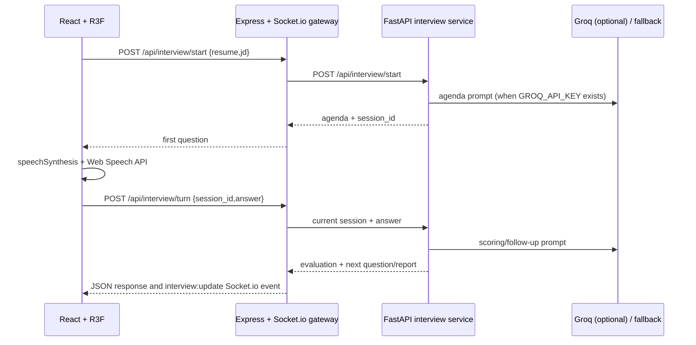

# AI Mock Interviewer architecture

The current frontend defaults to FastAPI on port 8000 for zero-configuration local
development. Set `VITE_INTERVIEW_API_URL=http://localhost:3001/api/interview`
to route interview traffic through the Node gateway.

## API contract

### `POST /api/interview/start`
Request: `{ "resume": "parsed resume text", "jd": "target job description" }`

Response: `{ session_id, agenda[], question, current_index, completed, total, history }`

### `POST /api/interview/turn`
Request: the start response plus `candidate_answer`.

Response while active: same session shape, plus `transition` and the next `question`.
Response when complete: `{ complete: true, report: { readiness_score, jd_match_percent, coaching_advice, breakdown[] } }`.

The Node gateway keeps session state in memory and emits `interview:update` to
clients that joined the session. Browser speech data is not persisted.
